# Clustering minute-level candlesticks (OptAlpha internship, June 2024)

During my ML internship at OptAlpha in June 2024, I explored whether one-minute candlesticks can be grouped into clusters that say something about what the next few candles do. This repo has my notebooks, the plots from my exploratory analysis, and a write-up of the task, the decisions I made, what I found, and what I'd do next.

## At a glance

- **Data:** 673,384 one-minute candles from January 2017 to May 2024, with open, high, low, close, volume and open interest. After dropping four badly truncated days, 672,260 candles remain.
- **Features:** I normalised every candle against an exponential moving average of the close. My reasoning was that an EMA suits short-term, per-minute data better than a simple average. I also built gradients of the EMA, volume and open interest, plus ten technical indicators written by hand in pandas.
- **Exploration:** 15 plots, most with an observation I wrote next to them. 13 of them are below.
- **Clustering:** two rounds of K-means.
  - Round 1 (3 clusters on price-level features) didn't separate anything useful.
  - Round 2 (6 clusters on scale-free candle-shape features) came out as six consecutive stretches of time between 2017 and 2024, which I read against market events. Why it split by time is explained under [Clustering](#why-the-round-2-clusters-follow-the-calendar).

## The task

The task was **clustering-based identification**: find groups of candles that behave differently, measured by what happens after them.

- **Inputs (X):** candle features built from date and time, OHLC, volume and open interest.
- **Target (Y):** based on close minus open over the next *n* candles. It comes in two forms:
  - *Y_cat*: how often the next *n* candles are green, red or neutral, with a threshold deciding "neutral";
  - *Y_num*: how much the price moves between open and close over the next *n* candles.
- **KPI:** a table of *cluster → Y_cat → Y_num*, so that clusters with a better Y stand out.
- **Suggested methods:** K-means, hierarchical clustering, and clustering in the latent space of a variational autoencoder.

## Data and cleaning

The data is a one-minute series supplied by OptAlpha. It starts at exactly 100.00 on 2 January 2017, so it appears to be rebased. The data file itself isn't in this repo, but the six charts saved in the v2 notebook with charts contain the open, high, low and close of every cleaned candle. A full trading day has 375 candles (09:15 to 15:29). Of the 1,797 days, 1,773 are complete.

**Cleaning:**
1. **Dropped four truncated days before 2022:** any earlier day with fewer than 370 candles. These were 10 July 2017 (220 candles), 13 March 2020 (316), 23 March 2020 (317) and 11 January 2021 (271), 1,124 candles in all. Shorter days from 2022 onwards were kept.
2. **Fixed NaNs in the indicators:** filled the first-row gaps, and added a tiny epsilon wherever a denominator could be zero (RSI, ADX, ultimate oscillator, wick ratios).

The cleaned candles (`cd.csv`) and the feature table (`df.csv`) were saved once, so the second-round notebook doesn't recompute them.

## Features

| Group | Features |
|---|---|
| Time | weekday; hour of the day |
| Candle | close − open (`oc`, body and colour); high − low (`hl`, range) |
| Trend | 10-candle EMA of the close |
| Normalised candle | open, high, low and close minus the EMA (`opnorm`, `hinorm`, `lonorm`, `clnorm`) |
| Gradients | EMA (1st and 2nd); volume (1st to 3rd); open interest (1st and 2nd), each over a rolling 10-candle window |
| Indicators | SMA (10); VWAP; MACD minus its signal line (12/26/9); 50-SMA minus 200-SMA (crossover gap); ultimate oscillator (7/14/28); disparity index; on-balance volume; accumulation/distribution; RSI (10); ADX (10) |
| Repetition | how often the current volume, high and low recur within the last 10 candles |

**The EMA decision.** The task sheet suggested normalising each candle against a moving mean of the past *n* candles, taken over the close, the open or their midpoint. I used the close, which is the usual choice. I used an exponential moving average instead, because it weights recent candles more heavily, which suits short-term, per-minute data. I then checked the normalisation by drawing the normalised candles. The first version (7 June) restarted the EMA every morning. From 16 June it runs continuously, using pandas' `ewm(span=10)`.

**Ideas considered and set aside:**
- **Economic indicators:** ECI, GDP, PMI, PCE, PPI, CPI and seasonality. These matter for long-term investing, not minute candles.
- **Coincident and lagging indicators:** GDP, employment figures, CPI, balance of trade. Same reason.
- **Other indicators I listed:** adjusted close, the stochastic oscillator and the dynamic momentum index, plus SMAs and EMAs over two or three different periods.
- **Moving-average crossovers:** the 50/200 crossover gap is in the feature table. My notes also record: "Technical indicators have been observed to not work for us."
- **Prediction models:** I noted echo state networks and LSTMs as options for a later prediction stage.

## What the data showed

These plots come straight from the saved outputs of the 7 June notebook. Each caption names the axes, says which candles are plotted, and gives my note on the plot. Unless stated otherwise, the candles are the last 60,000, roughly the last 160 trading days up to 24 May 2024. Two plots that just swapped the axes of another are left out; their notes appear under their twins, plots 6 and 7.

### When volatility and volume happen

| | |
|---|---|
| 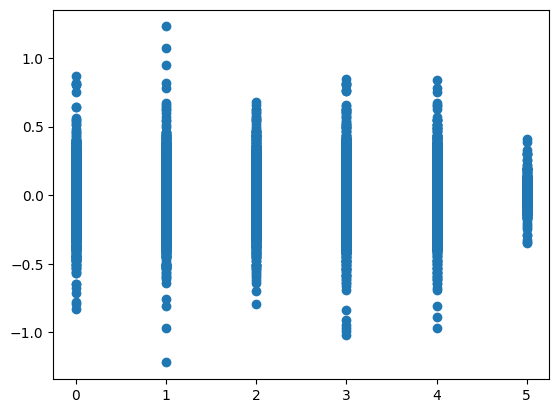 | 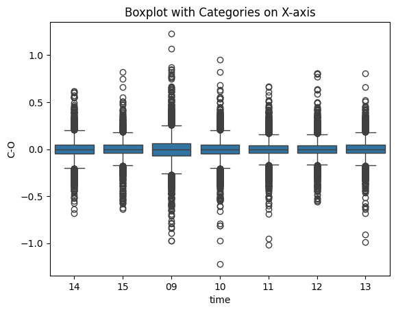 |
| **1.** x: weekday (0 = Monday … 5 = Saturday); y: close − open. *Tuesday had more spikes and falls, Saturday is quiet, and there are more fluctuations at the start and end of the work week.* | **2.** Box plot of close − open by hour of the day. *High volatility in the first two hours and the last hour before the market closes, calm at the very close and at lunchtime. Volatility generally slows through the day.* |
| 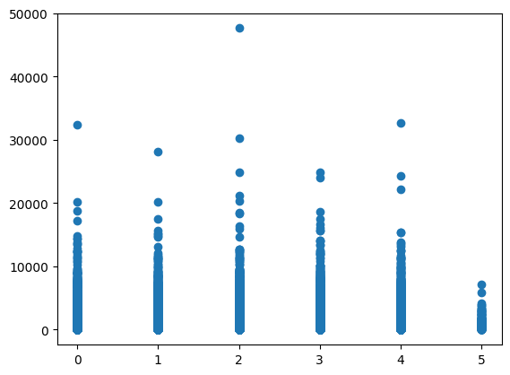 | 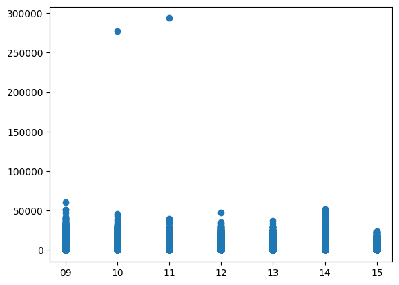 |
| **3.** x: weekday; y: volume. *Trading goes slow on Saturday. Tuesday, which had been found to be volatile, has fewer transactions. Wednesday was tranquil, but has volume spikes. Wednesday is the day for prudent trading, as fluctuations are low and volume is high.* | **4.** x: hour of the day; y: volume (all candles). *Volume slumps at midday and falls at the close.* |

### Volume and open interest

| | |
|---|---|
| 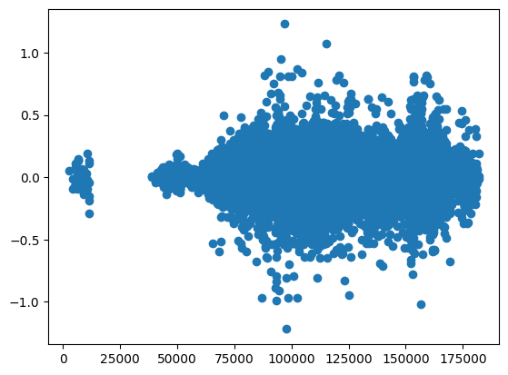 | 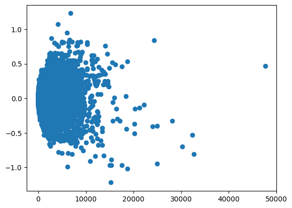 |
| **5.** x: open interest; y: close − open. Flagged for further analysis. | **6.** x: volume; y: close − open. Flagged for further analysis. |
| 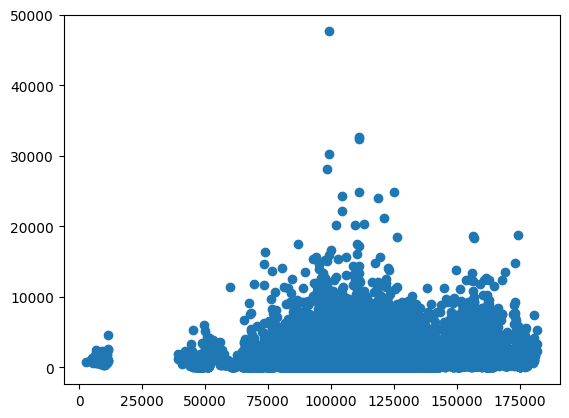 | 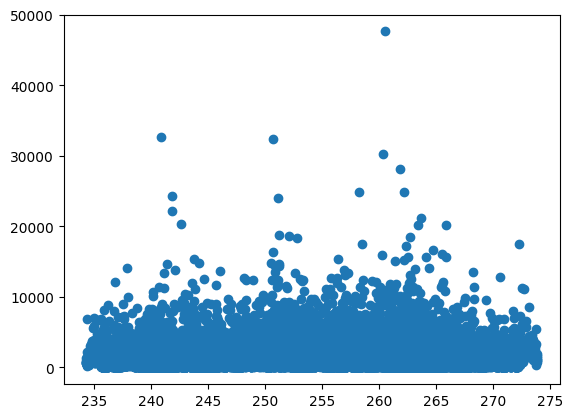 |
| **7.** x: open interest; y: volume. Flagged for further analysis. | **8.** x: EMA of the close; y: volume. Flagged for further analysis. |
| 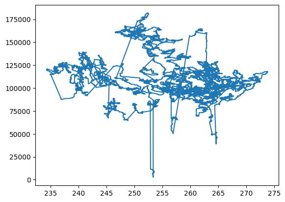 | |
| **9.** x: EMA of the close; y: open interest, as a line. *A complicated picture, unlikely to be useful.* | |

### Price and candle shape

| | |
|---|---|
| 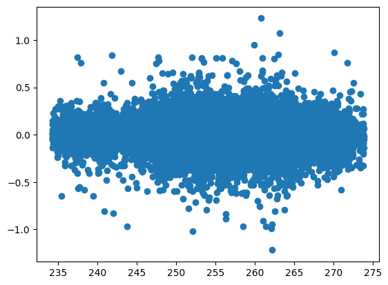 | 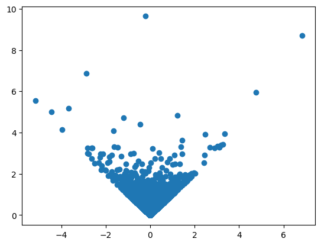 |
| **10.** x: EMA of the close; y: close − open. Flagged for further analysis. | **11.** x: close − open; y: high − low (all candles). *As expected, high `hl` leads to high `oc` magnitude.* |
| 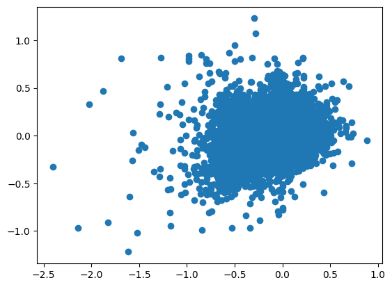 | 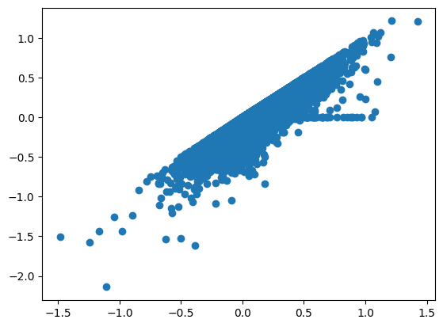 |
| **12.** x: low − EMA; y: close − open. *`oc` and `clnorm` are linearly related, and `oc` and `opnorm` are inversely related. A positive `hinorm` and a negative `lonorm` usually come with a positive `oc`.* | **13.** x: high − EMA; y: close − EMA. *No clear pattern at first glance.* |

Next on my list were density plots and heatmaps, and I had started distribution plots for the first few variables.

**What I took from this,** as summarised in my task notes:
- The start and end of the working week are the most volatile, with the biggest spikes and drops in close − open.
- The first two hours of trading are volatile, followed by increasing calm.
- Volume is high midweek and low around midday.
- How volume, close − open and open interest relate to each other didn't look useful. Nor did EMA against open interest, which was a complicated picture.
- A high high and a low low both point to volatility.

## Clustering

### Round 1: price-level features (7–21 June)

K-means with 3 clusters on the EMA, close − open, volume and open interest, using the last 60,000 candles. The plot projects the clusters onto two principal components.

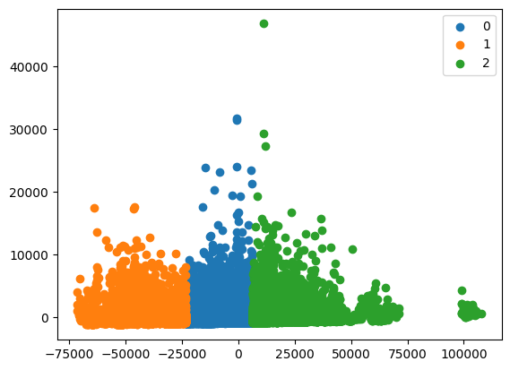

**14.** K-means (3 clusters) shown on the first two principal components.

The scatter plot didn't make the clusters clear, and my notes at the time asked for help with analysing them numerically. The cluster centres show why:

| Cluster | EMA | Close − open | Volume | Open interest |
|---|---:|---:|---:|---:|
| A | 253.4 | 0.0007 | 914 | 115,890 |
| B | 252.6 | 0.0009 | 1,290 | 151,752 |
| C | 258.2 | −0.0005 | 883 | 92,365 |

The clusters differ almost entirely in open interest. The features weren't scaled before clustering, so open interest (around 100,000) drowned out everything else, and close − open (around 0.001) had almost no say.

### Round 2: candle-shape features (21 June)

For the second round I described each candle by its shape rather than its price level:
- **Candle length:** (high − low) / low.
- **Body:** (close − open) / open, as a share of the candle length. It's signed, so it also carries the colour.
- **Upper and lower wicks:** each as a share of the candle length.
- **Volume gradient:** the first-order gradient of volume.

K-means with 6 clusters ran on all 672,260 cleaned candles. The PCA plot gave no information this time, so I drew each cluster as its own candlestick chart.

**What came out:** each cluster gathered the candles of one unbroken stretch of time, about 15 months long. I read each cluster's chart and matched it against what was happening in the market at the time:

| Cluster | Period | What its candles showed | My read | Context |
|---|---|---|---|---|
| 1 | 2018–2019 | fluctuation in the mid range | hold | Rafale controversy; long-term capital gains tax |
| 2 | 2023–2024 | set-up trend, high prices | good Y value | election season, euphoria of strong campaigning |
| 3 | end of 2020 – 2021 | increasing trend | optimistic | vaccines; the first wave had ebbed |
| 4 | 2017 – early 2018 | low prices, upward trend | not the time to invest; keep watching | GST and other economic decisions; the market gaining strength |
| 5 | 2022 – early 2023 | very volatile in the medium-high range | better to hold | wars |
| 6 | 2019–2020 | sharp drop from medium to low prices | avoid | the pandemic |

My conclusion at the time was that the events are in conformity with the trends. I also noted that the engineered features could be used for clustering next.

The six saved charts, redrawn from the same data; the originals are in the outputs of [`2024-06-21_candle_prediction_v2_with_charts.ipynb`](notebooks/2024-06-21_candle_prediction_v2_with_charts.ipynb). Five show the prices as supplied (rebased to 100 on 2 January 2017). The chart for cluster 1 shows EMA-normalised prices (price minus the 10-candle EMA), so it sits around zero. Gaps in the candles are nights, weekends and holidays.

| | |
|---|---|
| 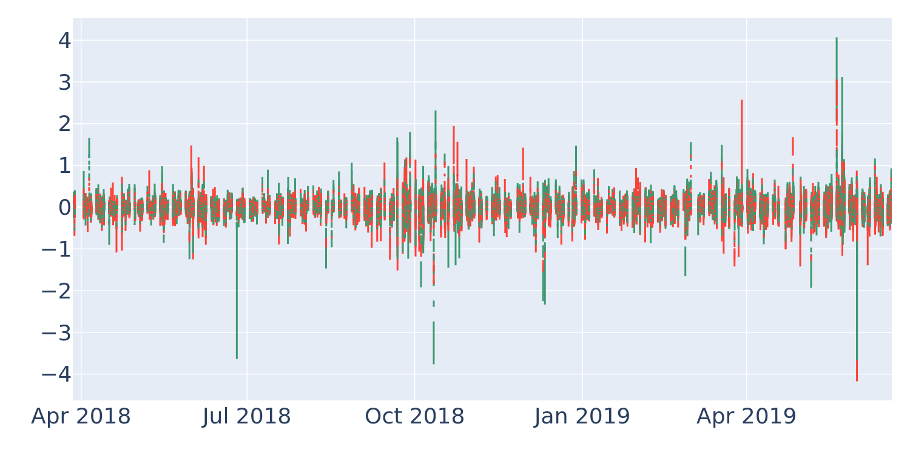 | 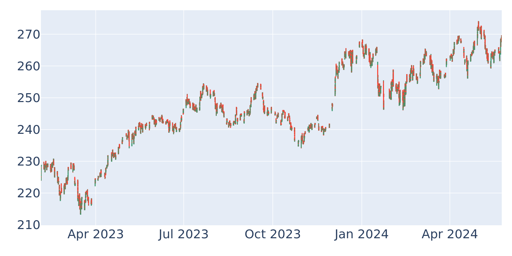 |
| **15.** Cluster 1: 27 Mar 2018 – 19 Jun 2019, 113,103 candles, EMA-normalised. | **16.** Cluster 2: 3 Feb 2023 – 24 May 2024, 111,240 candles. |
| 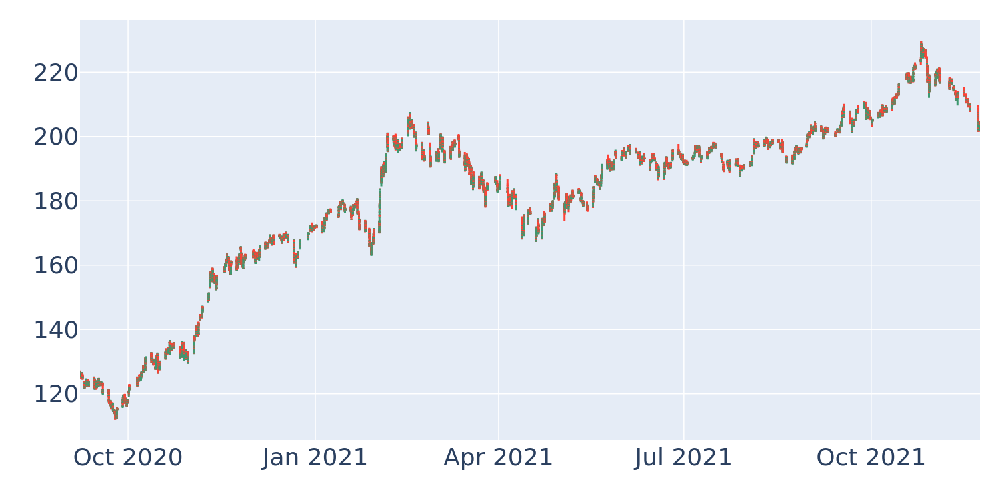 | 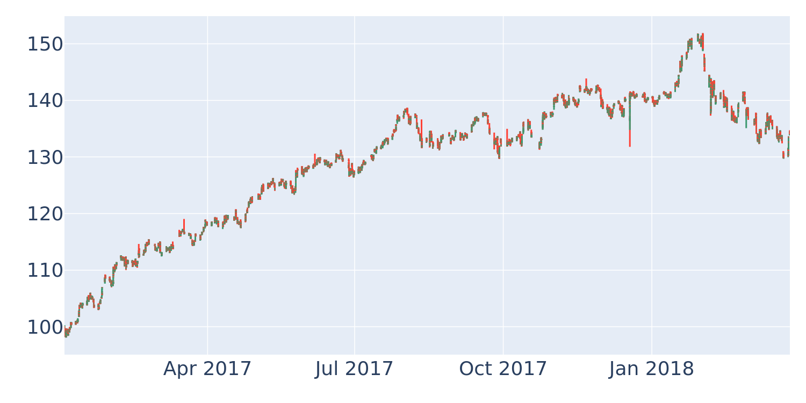 |
| **17.** Cluster 3: 7 Sep 2020 – 23 Nov 2021, 111,034 candles. | **18.** Cluster 4: 2 Jan 2017 – 27 Mar 2018, 114,074 candles. |
| 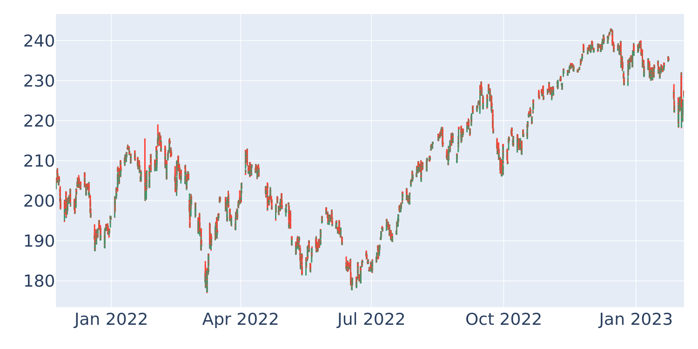 | 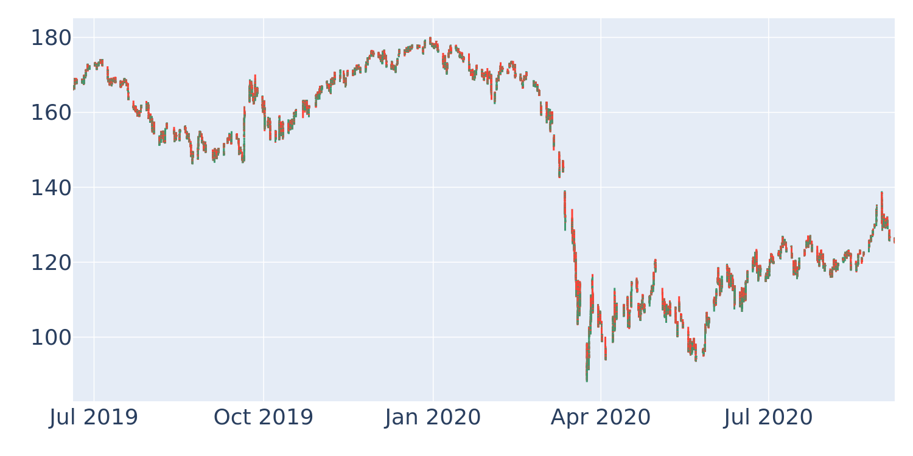 |
| **19.** Cluster 5: 23 Nov 2021 – 3 Feb 2023, 110,984 candles. | **20.** Cluster 6: 19 Jun 2019 – 7 Sep 2020, 111,825 candles. |

### Why the round-2 clusters follow the calendar

The time split points to how cell 10 was run, rather than to candle shape:

- **Cell 10 adds two columns to the feature table after fitting:** the cluster labels (`cdf['labels']`) and the row number (`cdf['index']`). If the cell runs a second time, K-means fits on those columns too. The row number runs from 0 to 672,259 and dwarfs every other feature, so the clusters become consecutive blocks of rows, which are consecutive stretches of time.
- **The saved charts show the cell did run more than once.** In [`2024-06-21_candle_prediction_v2_with_charts.ipynb`](notebooks/2024-06-21_candle_prediction_v2_with_charts.ipynb), cluster 1's chart uses normalised prices while the other five use raw prices. The candle at 10:30 on 27 March 2018 is in two charts, and the one at 14:35 on 19 June 2019 is in none. So the six charts come from at least two different fits.
- **The six charts are consecutive blocks of nearly equal size,** 110,984 to 114,074 candles each, which is the pattern clustering on the row number gives.

So the six charts are consecutive stretches of the calendar, and the readings above describe the market in each period.

### Not reached

The KPI table (cluster → Y_cat → Y_num) wasn't built in the work recorded here. The "green / red / neutral" label waited on a choice of neutrality threshold, which is noted in the code.

## What I'd do next

1. **Standardise the features and fit on a fresh copy of the feature table,** then rerun both rounds.
2. **Build the KPI table,** and judge clusters by Y rather than by how the plots look.
3. **Try the other methods from the task sheet,** hierarchical clustering and a VAE latent space, alongside clustering on groups of consecutive candles, not single ones.
4. **Split by time, not at random,** before moving on to any prediction model, so the test set always comes after the training data.

## Notebooks

All five ran in Google Colab with the data on Google Drive. They're unchanged except for their file names. Some plotting cells, mostly the Plotly candlestick charts, are commented out because they slowed execution during review calls. Uncomment them to regenerate the charts.

| Notebook | What it does |
|---|---|
| [`notebooks/2024-06-07_candle_prediction.ipynb`](notebooks/2024-06-07_candle_prediction.ipynb) | First pass: EMA restarted daily, normalised candles, all 15 exploratory plots, round-1 K-means and its PCA plot |
| [`notebooks/2024-06-16_candle_prediction.ipynb`](notebooks/2024-06-16_candle_prediction.ipynb) | Continuous EMA, the indicators, and the start of the search for truncated days |
| [`notebooks/2024-06-21_candle_prediction.ipynb`](notebooks/2024-06-21_candle_prediction.ipynb) | Cleaning, gradients, NaN fixes, the full feature table; saves `cd.csv` and `df.csv` |
| [`notebooks/2024-06-21_candle_prediction_v2.ipynb`](notebooks/2024-06-21_candle_prediction_v2.ipynb) | Round 2: shape features, K-means with 6 clusters, per-cluster candlestick charts. Run it after the 21 June notebook |
| [`notebooks/2024-06-21_candle_prediction_v2_with_charts.ipynb`](notebooks/2024-06-21_candle_prediction_v2_with_charts.ipynb) | The same round-2 notebook saved before its chart cells were commented out, with the six candlestick charts in its outputs. 40 MB, because the charts hold the open, high, low and close of every cleaned candle; download it to open it |

## Work log

| Date (2024) | Work |
|---|---|
| 4 June | Simple and exponential moving averages; differences between the OHLC values |
| 5 June | Visualised the candles; started K-means |
| 6 June | Tried K-means; plotted how the features vary |
| 7 June | Looked into technical indicators and ideas for a prediction model |
| 10 June | Distribution plots; started looking for clustering ideas |
| 11 June | Gradients of the features; looked for more features |
| 12 June | Added more features |
| 13 June | Clustering ideas; searched the data for discontinuities |
| 14 June | Removed the discontinuous days; updated the data frames |
| 17 June | Prepared the clustering data; scatter plot |
| 18 June | Fixed features that contained NaNs |
| 19 June | Candlestick charts with mplfinance and Plotly |
| 20 June | Normalised candlestick charts; first insights from normalised and raw OHLC plots |
| 21 June | Looked for deeper insights in the charts; listed more clustering ideas |

## Literature review

Towards the end of the internship, I reviewed what others had done with candlestick patterns and clustering, as approaches for the next stage:

| Source | What it offered | Limitations | Useful? |
|---|---|---|---|
| ATAS, ["Searching candle patterns and clusters"](https://atas.net/volume-analysis/strategies-and-trading-patterns/searching-candles-patterns-and-clusters/) | new indicators for short-term markets; clusters denote trends | cluster analysis is manual and context-based, no methodology | No |
| A. D. Mann and D. Gorse, "Deep candlestick mining," ICONIP 2017. [doi:10.1007/978-3-319-70096-0_93](https://doi.org/10.1007/978-3-319-70096-0_93) | more and better predictive patterns | no code; complex to implement | Yes |
| TrendSpider, ["Analysis shows stock prices tend to cluster"](https://trendspider.com/blog/analysis-shows-stock-prices-tend-to-cluster/) | candlestick patterns are unreliable, and prices tend to cluster | not predictive; average price vs volume plot; long-term | No |
| I. Orquín-Serrano, "Predictive power of adaptive candlestick patterns in forex market. EURUSD case," Mathematics 8(5), 802, 2020. [doi:10.3390/math8050802](https://doi.org/10.3390/math8050802) | adaptive candlestick patterns | mainly compares trading strategies; no code | No |
| X. Chen, W. Hu and L. Xue, "Stock price prediction using candlestick patterns and sparrow search algorithm," Electronics 13(4), 771, 2024. [doi:10.3390/electronics13040771](https://doi.org/10.3390/electronics13040771) | ready-made prediction model; recent | no code; the search algorithm may be expensive; daily candles; stock prices | Yes |
| Y. Lin et al., "Improving stock trading decisions based on pattern recognition using machine learning technology," PLOS ONE, 2021. [doi:10.1371/journal.pone.0255558](https://doi.org/10.1371/journal.pone.0255558) | ready-made prediction model | stock prices; 1–10 day windows | Yes |
| Y. Lin, S. Liu, H. Yang and H. Wu, "Stock trend prediction using candlestick charting and ensemble machine learning techniques with a novelty feature engineering scheme," IEEE Access, 2021. [doi:10.1109/ACCESS.2021.3096825](https://doi.org/10.1109/ACCESS.2021.3096825) | predictive; picks the model with the best predictions | low accuracy; daily candles; focused on building strategies | Yes |
| J.-H. Chen and Y.-C. Tsai, "Encoding candlesticks as images for pattern classification using convolutional neural networks," Financial Innovation 6, 26, 2020. [doi:10.1186/s40854-020-00187-0](https://doi.org/10.1186/s40854-020-00187-0) | high accuracy in pattern recognition | no clustering; prediction still manual | No |
| Y. Patil and M. Joshi, "Cluster driven candlestick method for stock market prediction," ICSCAN 2020. [IEEE Xplore 9262356](https://ieeexplore.ieee.org/document/9262356) | works better for smaller time steps; covers all NSE stocks; a predictive clustering model with an algorithm | accuracy still low | Yes |

Also used: QuantStart, ["K-means clustering of daily OHLC bar data"](https://www.quantstart.com/articles/k-means-clustering-of-daily-ohlc-bar-data/), and a [K-means candlestick notebook for Ethereum](https://github.com/samuelclk/ethcandleclusters/blob/master/ethuat%20kmeans%20candlesticks%20250817.ipynb).
